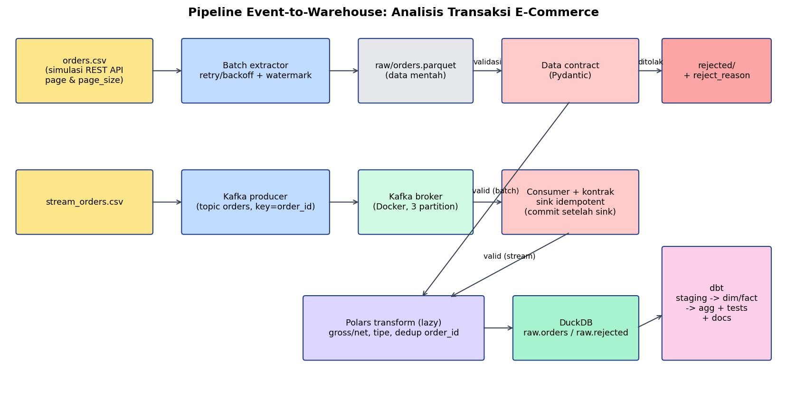

# Laporan Teknis — Mini Project Praktikum Data Processing Workflow
**End-to-End Event-to-Warehouse Pipeline: Analisis Transaksi E-Commerce**
Nama: **[ISI]** · NRP: **[ISI]** · Mode: individu

> Petunjuk pengisian: bagian **[ISI]** adalah angka yang harus disalin dari `evidence/` hasil eksekusimu sendiri. Angka tanpa tanda [ISI] berasal dari desain/konfigurasi.

## 1. Ringkasan & arsitektur
Pipeline menggabungkan data historis (batch, CSV yang berperan sebagai REST API berpaginasi) dan event baru (Kafka). Data divalidasi dengan kontrak Pydantic; yang lolos ditransformasi dengan Polars, dimuat ke DuckDB, lalu dimodelkan dengan dbt (staging → star schema → agregat) lengkap dengan tes dan dokumentasi.

Sumber batch: `data/orders.csv` resmi dari dosen (36 baris; 30 memenuhi kontrak, 6 melanggar: quantity 0, harga negatif, diskon 1,2, timestamp `not-a-date`, status `pending`, customer_id kosong). Sumber streaming: `data/stream_orders.csv`, 40 event sintetis (seed 42, 6 cacat) karena data resmi hanya 36 baris dan tidak boleh tumpang tindih dengan batch. Benchmark/skew memakai data sintetis berskala besar (resmi terlalu kecil untuk pengukuran waktu).

## 2. Keputusan desain
| Keputusan | Alasan | Konsekuensi |
|---|---|---|
| Parquet mentah bertipe string | Raw harus mencerminkan sumber apa adanya; tipe diperkuat setelah kontrak | Parsing di tahap kontrak/transform |
| Watermark `order_ts`, filter `>` | Data sumber terurut waktu; sederhana & dapat diaudit | Baris dengan ts identik di batas bisa terlewat (di data ini ts unik per baris); ts rusak hanya via full load |
| Watermark ditulis setelah semua penulisan sukses | Jika proses gagal di tengah, run berikutnya mengulang (aman karena idempoten) | Kemungkinan baca ulang, bukan kehilangan data |
| Idempotensi berlapis (baris identik, `order_id`, sink, `CREATE OR REPLACE`) | Pengulangan proses tidak menggandakan efek bisnis | Dedup memakai "first wins"; pembaruan status order perlu strategi upsert/versi (lihat §8) |
| Kafka key = `order_id`, commit manual setelah sink | Urutan per order & tidak ada pesan hilang | At-least-once → duplikat teknis mungkin; ditangani sink idempoten |
| Polars lazy untuk transform | Optimasi rencana (projection/predicate pushdown) | Debug lebih sulit; `explain()` membantu |
| dbt mart sebagai star schema | Query bisnis sederhana, join sedikit | Dimensi denormalisasi (redundansi kecil) |

## 3. Batch/API ingestion (Topik 1)
- **Pagination:** `page`, `page_size=10`; loop hingga `has_next=False` → 4 halaman untuk 36 record (10+10+10+6). Bukti: `evidence/log_batch_run1.txt` (jumlah halaman & record per halaman).
- **Retry/backoff:** `src/retry.py`; jeda `min(8, 0.5·2^n)` + jitter 10% → 0,5 s, 1 s, 2 s, 4 s, 8 s; maksimum 5 retry. Simulasi: `--simulate-failures 3` membuat 3 panggilan pertama gagal (HTTP 503 simulasi) lalu pulih. Bukti: baris WARNING pada log run 1 (jumlah percobaan & jeda).
- **Watermark:** `state/watermark.json`. Tabel hasil dua/tiga eksekusi (salin dari `evidence/incremental_run1_run2.md`):

| Metrik | Run 1 | Run 2 | Run 3 (baca ulang penuh) |
|---|---|---|---|
| record dibaca | [ISI] | [ISI] | [ISI] |
| raw ditambahkan | [ISI] | [ISI] | [ISI] |
| valid ditambahkan | [ISI] | [ISI] | [ISI] |
| ditolak | [ISI] | [ISI] | [ISI] |
| order_id unik (valid) | [ISI] | [ISI] | [ISI] |

  Kesimpulan yang diharapkan & harus dibuktikan oleh log: run 2 dan run 3 menambah 0 data baru.
- **Parquet:** `raw/orders.parquet` (dibaca ulang oleh `src/check_parquet.py` → `raw_parquet_check.txt`).

## 4. Streaming (Topik 2)
- Docker Compose: Kafka 4.2.1 KRaft single broker; topic `orders` dibuat dengan 3 partition, RF=1.
- Producer (`acks=all`, idempotent producer) menerbitkan 40 event dari `stream_orders.csv`; key = `order_id`.
- Consumer: membaca, validasi kontrak, tulis `stream_valid.jsonl` / `stream_rejected.jsonl` (alasan penolakan + partition/offset).
- **Partition:** unit paralelisme & urutan; urutan hanya dijamin dalam satu partition, maka key = `order_id`.
- **Consumer group:** consumer dengan `group.id` sama membagi partition (tiap partition satu consumer aktif); anggota keluar → rebalance.
- **Offset:** posisi record dalam satu partition; *committed offset* per (group, topic, partition) menentukan titik lanjut; LAG = log-end − current.
- **At-least-once vs exactly-once:** at-least-once (commit setelah sink) tidak menghilangkan pesan tetapi dapat memproses ulang setelah crash; exactly-once Kafka (transactional producer + `send_offsets_to_transaction` + `read_committed`) hanya menjamin alur Kafka→Kafka. Hasil eksperimen Modul 3: lihat `kafka_modul3/praktikum_bagian3/experiment-report.md`.
- **Uji duplikasi:** `producer --count 5 --duplicate-demo` mengirim event pertama dua kali, lalu 40 event penuh (5 pertama replay). Hasil dari `stream_summary.txt`: valid=[ISI], unik=[ISI], duplikat dilewati=[ISI] (baris log `DUPLIKAT dilewati`).
- **Batas jaminan implementasi:** pemrosesan **at-least-once** dengan **sink idempoten berbasis `order_id`** (set `seen` dimuat dari file). Tidak atomik antara penulisan file dan commit offset; bila crash terjadi setelah tulis sebelum commit, pesan dibaca lagi dan dilewati sink. Tidak ada klaim exactly-once end-to-end. Jika file sink dihapus tetapi offset sudah commit, data tidak akan terisi ulang.

## 5. Data contract (Topik 3)
Pydantic v2 (`extra="forbid"`): `order_id`/`customer_id` min 1 karakter; `quantity` int > 0 (“2.5” ditolak); `unit_price` ≥ 0; `discount_pct` ∈ [0,1]; `order_ts` datetime valid (naive = UTC); `status` ∈ {paid, shipped, cancelled, refunded}. Mode `--fail-fast` melempar `ContractViolation` pada pelanggaran pertama; mode normal memisahkan valid/rejected dan menyimpan record asli + `reject_reason` + `reject_fields`.
Bukti: `evidence/validation_cases.csv` (15 kasus uji), `rejected/rejected_orders_batch.csv`, query `raw.orders` JOIN `raw.rejected_orders` = 0 (`log_load_warehouse.txt`) dan dbt singular test `assert_no_rejected_in_fact`.
Penyebab penolakan terbesar: **[ISI dari analytics_answers.md bagian 5b]**; total ditolak: **[ISI]**.

## 6. Transformasi & optimasi (Topik 4)
- `gross_amount = quantity × unit_price`; `net_amount = gross_amount × (1 − discount_pct)`; timestamp → `Datetime`; tipe eksplisit. Verifikasi sampel manual: `evidence/transformation_check.csv`.
- **Benchmark** (`evidence/pandas_polars_benchmark.csv`): dataset sintetis **[ISI]** baris (±[ISI] MB), pekerjaan identik (baca CSV → parse ts → gross/net → group by tanggal×kategori), 5 pengulangan + 1 warm-up, median. Hasil: pandas [ISI] s; Polars eager [ISI] s; Polars lazy [ISI] s; lingkungan: [ISI CPU/RAM/versi dari CSV].
  *Keterbatasan:* satu mesin, satu jenis pekerjaan, data sintetis, cache OS, variasi beban latar; hasil tidak boleh digeneralisasi.
- **Lazy vs eager:** `scan_csv/scan_parquet` + `collect()` membangun rencana yang dioptimasi (`lazy_query_plan.txt`: hanya kolom yang dibutuhkan dibaca); eager mengeksekusi & mematerialisasi tiap langkah.
- **Skew** (`evidence/skew_experiment.md`): satu customer digandakan hingga ±50% baris. Distribusi sebelum → sesudah: max grup [ISI] → [ISI]; waktu `group_by` pandas [ISI]→[ISI] s, Polars [ISI]→[ISI] s. **Tidak ada uji/klaim OOM.**
- **Strategi mitigasi:** pemrosesan bertahap (chunk/`iter_slices`/streaming engine), proyeksi kolom (baca hanya kolom perlu), agregasi parsial dua tahap, hindari materialisasi tidak perlu (tetap lazy sampai akhir), partisi Parquet per tanggal; pada sistem terdistribusi gunakan *salting* untuk key dominan. Hubungan ke temuan: [ISI satu kalimat dari angka skew-mu].

## 7. Warehouse & dbt (Topik 5)
- DuckDB `warehouse/warehouse.duckdb`: `raw.orders`, `raw.rejected_orders` (idempotent `CREATE OR REPLACE`).
- dbt: `stg_orders`, `stg_rejected_orders`; `dim_customer`, `dim_product_category`, `dim_payment_method`, `dim_date`; `fct_orders` (grain: 1 baris/order); `agg_daily_sales`, `agg_sales_by_category`, `agg_orders_by_status`, `agg_payment_method_usage`, `agg_rejection_reasons`. Diagram: `diagrams/star_schema.puml`.
- Tes: `unique`, `not_null`, `relationships` (fct→4 dimensi), `accepted_values` status, dan 2 singular test (net amount benar; rejected tidak masuk fact). Hasil `dbt test`: **[ISI: PASS=x WARN=y ERROR=z dari dbt_test.log]**.
- Dokumentasi: `dbt docs generate` → `dbt_project/target/index.html` + screenshot lineage (`evidence/dbt_docs.png`).
- **Star vs snowflake:** star = dimensi denormalisasi satu tingkat (join sedikit, query cepat/sederhana, redundansi lebih besar); snowflake = dimensi dinormalisasi bertingkat (mis. kategori → departemen; hemat ruang/konsistensi, join lebih banyak). Di sini dipilih star karena dimensi kecil dan fokus analitik.
- **Incremental model dibutuhkan** saat fact tumbuh besar dan append-only/jarang berubah sehingga membangun ulang seluruh tabel mahal: dbt hanya memproses baris baru (`is_incremental()` + `unique_key=order_id`). Risiko: data terlambat (late-arriving) dan perubahan status → perlu lookback window atau `merge/delete+insert`. Pada proyek ini fact sangat kecil (30–70 baris) sehingga `table` penuh dipilih.

## 8. Hasil analitik (dari `evidence/analytics_answers.md`)
1. Penjualan bersih per hari: [ISI ringkas: rentang & contoh nilai].
2. Kategori tertinggi: **[ISI]** (net [ISI]).
3. Pesanan menurut status: [ISI jumlah & nilai].
4. Metode pembayaran terbanyak: **[ISI]** ([ISI]%).
5. Record ditolak: **[ISI]**; penyebab terbesar: **[ISI]**.

## 9. Keterbatasan
Data sintetis & satu mesin; benchmark tidak representatif; Kafka single broker RF=1 (tidak toleran gagal broker); sink file tidak atomik dengan offset; dedup "first wins" tidak menangani perubahan status order (butuh upsert versi terbaru); watermark `>` rentan pada ts identik; CSV bukan REST API sungguhan (retry disimulasikan).

## 10. Pembagian pekerjaan & penggunaan alat bantu
Individu — seluruh bagian dikerjakan oleh penulis. **[ISI: cantumkan penggunaan alat bantu AI/rujukan sesuai aturan mata kuliah.]**

## 11. Refleksi teknis
**[ISI 1 paragraf dengan kata-katamu: apa yang paling sulit, apa yang diperbaiki jika ada waktu lagi, mis. upsert status, partisi Parquet, exactly-once via transaksi.]**
